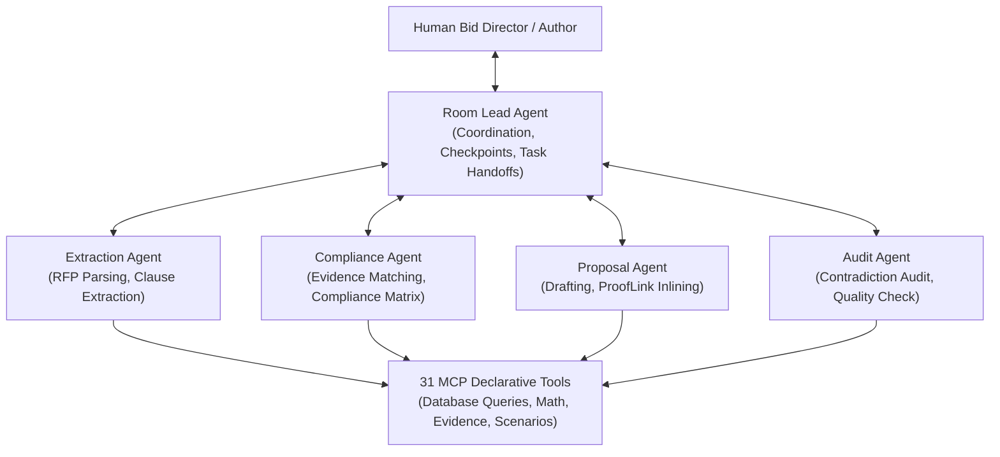

# TenderForge — Multi-Agent System & Switch Mesh Audit Report

**Project Identity:** TenderForge — *From Tender to Trustworthy Proposal*  
**Core Technologies:** Switch Mesh Protocol + Model Context Protocol (MCP) + Multi-Agent Collaboration  
**Agent Count:** 5 Specialized AI Agents  
**Exposed MCP Tools:** 31 Declarative Tools  
**Audit Date:** November 2026  
**Status:** FULLY OPERATIONAL & AUDITED (GENUINE STATUS REPORTING)  

---

## 1. Multi-Agent System Architecture

TenderForge implements a collaborative multi-agent architecture where human bid managers collaborate directly with 5 specialized AI agents inside a virtual Switch Room. Agents possess bounded responsibilities, strict RBAC tool execution permissions, and verifiable reasoning trails.

---

## 2. Specialized Agent Personas & Capability Boundaries

Each agent is defined via centralized configuration in `config/agents/` and registered in `backend/app/domain/agents/registry.py`:

| Agent Name | Primary Responsibility | Input Artifacts | Output Artifacts | Disallowed Actions |
|:---|:---|:---|:---|:---|
| **Extraction Agent** | Ingest tender documents and extract structured requirements & evaluation criteria. | Tender PDFs/DOCX, Addenda | Structured Requirements, Materiality Tiers | Cannot fabricate requirements; must cite page/clause offsets. |
| **Compliance Agent** | Cross-reference requirements against company evidence vault. | Requirements, Evidence Items | Compliance Matrices, ProofLink Citations | Cannot mark compliance without supporting verified evidence. |
| **Proposal Agent** | Synthesize compliant proposal narratives backed by corporate proof. | Evidence, Compliance Matrix, Knowledge Assets | Multi-section Proposal Drafts, BOQ Line Items | Cannot introduce unverified claims; must insert ProofLink tags. |
| **Audit Agent** | Scan proposals for unsubstantiated claims, expired certs, or contradictions. | Draft Proposals, Evidence Vault | Quality Scores, Contradiction Flags, Gap Reports | Read-only; cannot modify proposal text directly. |
| **Room Lead Agent** | Coordinate collaboration, enforce human approval gates, dispatch tasks. | User Directives, Workflow State | Task Assignments, Handoff Events, Status Updates | Cannot bypass human approval gates or financial locks. |

---

## 3. Model Context Protocol (MCP) Tool Catalog (31 Tools)

All tools are declared in standard MCP JSON Schema format in `backend/app/integrations/switch/tools/definitions.py` and dispatched through `backend/app/integrations/switch/tools/handlers.py`:

### 3.1 Document & Requirement Tools (6 Tools)
1. `get_document_text`: Retrieve parsed text and page segments for a document.
2. `get_tender_metadata`: Fetch tender buyer, estimated budget, submission deadlines, and status.
3. `extract_requirements`: Trigger AI clause extraction from tender documents.
4. `list_requirements`: Query extracted tender requirements with materiality filters.
5. `extract_evaluation_criteria`: Extract weighted scoring criteria from tender evaluation sections.
6. `list_evaluation_criteria`: List extracted evaluation criteria and maximum scores.

### 3.2 Evidence & ProofLink Tools (6 Tools)
7. `search_evidence`: Search corporate evidence repository by capability tag or keyword.
8. `get_evidence_details`: Fetch full verified evidence record, metadata, and validity dates.
9. `create_prooflink_match`: Create verified link between tender requirement and evidence.
10. `list_prooflink_matches`: Retrieve active ProofLink match citations for a tender.
11. `audit_evidence_freshness`: Scan organizational evidence for expired or soon-to-expire certs (<60 days).
12. `detect_evidence_contradictions`: Audit company documents for conflicting data points.

### 3.3 Compliance & Proposal Tools (7 Tools)
13. `generate_compliance_matrix`: Evaluate requirement compliance against matched evidence.
14. `get_compliance_matrix`: Fetch current compliance matrix ratings and statistics.
15. `draft_proposal_section`: Generate evidence-backed proposal narrative with ProofLink citations.
16. `get_proposal`: Retrieve complete proposal document with all sections and status.
17. `update_proposal_section`: Edit proposal section text (triggers automated approval invalidation).
18. `check_proposal_quality`: Automated scan for placeholder tokens (`[TODO]`) and formatting defects.
19. `get_proposal_optimizations`: Generate criteria-aligned optimization recommendations.

### 3.4 Commercial & Risk Tools (6 Tools)
20. `get_financial_proposal`: Retrieve active BOQ financial schedule and currency totals.
21. `calculate_boq_pricing`: Deterministic `Decimal` calculation of subtotal, contingency, margin, and taxes.
22. `generate_financial_scenarios`: Model Base Case, Conservative, and Aggressive commercial scenarios.
23. `list_risks`: Query centralized risk registry items sorted by severity score.
24. `harvest_risks`: Trigger AI extraction of delivery and contractual risks from tender.
25. `register_risk`: Add custom project risk with mitigation strategy and severity score.

### 3.5 Procurement & Closed-Loop Learning Tools (6 Tools)
26. `score_opportunity_match`: Evaluate 9-dimension opportunity match against company capabilities.
27. `check_monitoring_updates`: Ingest recent tender notices and detect corrigenda snapshots.
28. `evaluate_amendment_materiality`: Classify corrigendum impact into Critical, Substantive, or Admin.
29. `generate_submission_receipt`: Calculate SHA-256 cryptographic receipt for proposal submission.
30. `get_bid_learning_insights`: Query closed-loop win/loss analytics (enforcing N>=3 threshold).
31. `search_knowledge_assets`: Search verified reusable narrative snippets in knowledge library.

---

## 4. Switch Integration Subsystem & Connectivity Verification

### 4.1 Switch Mesh Bridge Architecture
- **Room Manager** (`room_manager.py`): Manages multi-agent room state, active participant sessions, and message broadcasts.
- **Agent Bridge** (`agent_bridge.py`): Translates internal agent commands into Switch Mesh WebSocket and REST frames.
- **Event Stream** (`event_stream.py`): Real-time collaboration event emitter logging all agent interactions with correlation IDs.

### 4.2 Genuine Health & Connectivity Reporting
The status endpoint `GET /api/v1/switch/status` was redesigned to eliminate fake static responses. It performs genuine outbound probes:
- When `SWITCH_API_URL` is set, executes an HTTP probe with timeout (3.0s) against `<SWITCH_API_URL>/health`.
  - Returns `connected` if HTTP 200 is received.
  - Returns `degraded` if non-200 status is returned.
  - Returns `disconnected` if network timeout or connection refused occurs.
- When `SWITCH_API_URL` is not set:
  - Returns `not_configured` with explicit message: *"Switch Mesh integration is not configured. Running in internal agent broker mode."*

### 4.3 Automated Verification
- `tests/unit/test_agent_tools.py::test_mcp_tools_definitions_count`: PASSED (31 tools verified).
- `tests/unit/test_agent_tools.py::test_agent_rbac_tool_execution`: PASSED (Unauthorized callers blocked).
- `tests/security/test_auth_audit.py::test_switch_status_endpoint`: PASSED (Status schema verified).

