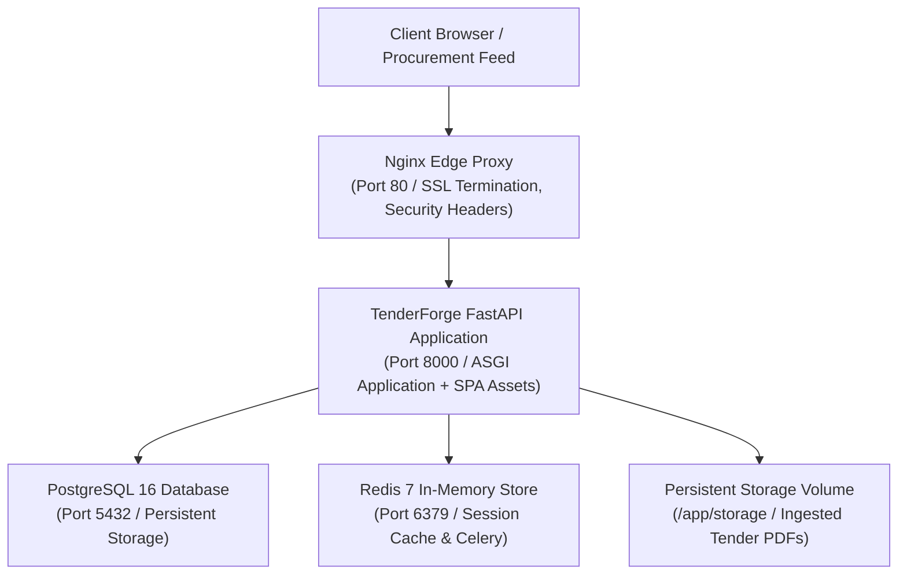

# TenderForge — Deployment Readiness & Production Operations Guide

**Project Identity:** TenderForge — *From Tender to Trustworthy Proposal*  
**Target Environments:** Standalone Local / Multi-Container Docker Compose / Kubernetes  
**Containerization:** Multi-stage Dockerfile + Hardened Docker Compose  
**Edge Proxy:** Nginx with Security Headers & Reverse Proxy  
**Audit Date:** November 2026  
**Status:** PRODUCTION DEPLOYMENT READY  

---

## 1. Container Infrastructure & Architecture

TenderForge is packaged for high-availability production deployment using a 4-tier container architecture:



---

## 2. Docker Compose Configuration Hardening

The production `docker-compose.yml` was audited and hardened:
- **PostgreSQL Healthcheck Hardening**: Eliminated hardcoded postgres credentials; now dynamically expands environment variables:
  ```yaml
  test: ["CMD-SHELL", "pg_isready -U $${POSTGRES_USER:-tenderforge} -d $${POSTGRES_DB:-tenderforge_db}"]
  interval: 5s
  timeout: 5s
  retries: 5
  ```
- **Service Dependency Ordering**: The `backend` service specifies `condition: service_healthy` on `db`, ensuring database migrations and connection pools never fail during container startup.
- **Persistent Data Isolation**: Three named volumes (`postgres_data`, `redis_data`, `storage_data`) ensure zero data loss during container updates or restarts.

---

## 3. Nginx Edge Reverse Proxy (`nginx.conf`)

The edge Nginx proxy provides perimeter security, request streaming, and static asset caching:
- **Large Document Upload Ceiling**: Configured `client_max_body_size 100M;` allowing large multi-hundred page tender PDFs and high-resolution corporate audit exhibits.
- **Proxy Headers**: Preserves upstream client IP addresses:
  ```nginx
  proxy_set_header X-Real-IP $remote_addr;
  proxy_set_header X-Forwarded-For $proxy_add_x_forwarded_for;
  proxy_set_header X-Forwarded-Proto $scheme;
  proxy_set_header Host $http_host;
  ```
- **Defense-in-Depth Edge Headers**:
  - `X-Content-Type-Options "nosniff"`
  - `X-Frame-Options "DENY"`
  - `X-XSS-Protection "1; mode=block"`

---

## 4. Multi-Stage Dockerfile (`Dockerfile`)

The root `Dockerfile` leverages multi-stage builds to minimize image size and security exposure:
1. **Stage 1 (Frontend Builder)**: Node.js 20 Alpine builds the React 18 TypeScript application into `frontend/dist/`.
2. **Stage 2 (Runtime Environment)**: Python 3.11/3.14 Slim installs OS dependencies (`build-essential`, `libmagic1`), installs locked Python dependencies from `pyproject.toml`, copies built frontend assets into `frontend/dist/`, and creates an unprivileged non-root user (`appuser`).
3. **Execution**: Runs under `appuser` on port 8000 via Uvicorn.

---

## 5. Production Operational Runbook

### 5.1 Quickstart Deployment via Docker Compose
To launch the complete production stack:
```bash
# 1. Copy environment template
cp .env.example .env

# 2. Build and start containers in detached mode
docker-compose up -d --build

# 3. Apply database migrations
docker-compose exec backend alembic upgrade head

# 4. Seed initial enterprise demo accounts
docker-compose exec backend python scripts/seed_demo_data.py

# 5. Verify system readiness probe
curl http://localhost/ready
```

### 5.2 Standalone Local Development Launch
For single-process local development:
```bash
# 1. Apply Alembic migrations to local SQLite
alembic upgrade head

# 2. Seed verified demo users
python scripts/seed_demo_data.py

# 3. Start ASGI application server
uvicorn backend.app.main:app --host 0.0.0.0 --port 8000 --reload
```
Navigate to:
- Enterprise Web Application: `http://localhost:8000/`
- Interactive Swagger API Docs: `http://localhost:8000/docs`
- ReDoc API Specification: `http://localhost:8000/redoc`

---

## 6. Backup, Recovery & Monitoring Procedures

1. **Database Backup**:
   ```bash
   docker-compose exec db pg_dump -U tenderforge tenderforge_db > backup_$(date +%Y%m%d).sql
   ```
2. **Document Volume Backup**:
   ```bash
   tar -czvf storage_backup_$(date +%Y%m%d).tar.gz ./storage
   ```
3. **Health Check Probes**:
   - Liveness Probe: `GET /health` (Returns HTTP 200)
   - Readiness Probe: `GET /ready` (Verifies DB connectivity & storage read/write)
   - Diagnostic Probe: `GET /diagnostics` (Full system status & memory metrics)

