# TenderForge — Frontend Functional & UI/UX Audit Report

**Project Identity:** TenderForge — *From Tender to Trustworthy Proposal*  
**Architecture:** React 18 SPA + TypeScript 5 + TailwindCSS / Production Pre-bundled Static SPA  
**Distribution Target:** `frontend/dist/index.html` (Served by FastAPI at `GET /` and `/assets`)  
**Audit Date:** November 2026  
**Status:** FULLY COMPLIANT & FUNCTIONALLY OPERATIONAL  

---

## 1. Executive Summary & Defect Remediation

Prior to this final audit, the frontend contained hardcoded development artifacts:
1. `frontend/src/api/client.ts` injected client-asserted `X-User-Role` and `X-User-Id` headers from `localStorage`.
2. `frontend/src/App.tsx` defaulted to an unauthenticated mock admin profile (`usr-system-admin`), concealing real authentication flows.
3. The Switch Mesh status indicator was static green without evaluating genuine connectivity.

**Remediation Applied & Verified**:
- All client-injected identity headers (`X-User-Role`, `X-User-Id`) were completely eliminated.
- The UI now performs genuine session authentication via `GET /api/v1/auth/me`. If unauthenticated or expired, it renders an Enterprise Authentication Dialog with login, registration, and 1-click verified demo credentials (`admin@tenderforge.com`, `author@tenderforge.com`, `reviewer@tenderforge.com`).
- The Switch Mesh status indicator now dynamically evaluates `/api/v1/switch/status`, displaying honest real-time states (`Connected`, `Degraded`, `Disconnected`, or `Not Configured`).
- Both `frontend/src/App.tsx` and the production bundle `frontend/dist/index.html` were updated and synchronized.

---

## 2. Navigation Architecture & View Coverage

The frontend is structured into 5 cohesive operational modules covering all 14 stages of the tender lifecycle:

```mermaid
flowchart TD
    NAV["TenderForge Enterprise Navigation"] --> TAB1["1. Core Platform"]
    NAV --> TAB2["2. Tender Intelligence"]
    NAV --> TAB3["3. Evidence & Proposals"]
    NAV --> TAB4["4. Procurement Intelligence"]
    NAV --> TAB5["5. Multi-Agent Collaboration"]

    TAB1 --> V1["Dashboard Overview"]
    TAB1 --> V2["Document Ingestion"]
    TAB1 --> V3["Tender Pursuits"]

    TAB2 --> V4["Requirement Extraction"]
    TAB2 --> V5["Compliance Evaluation"]
    TAB2 --> V6["ProofLink Traceability"]

    TAB3 --> V7["Company Evidence Vault"]
    TAB3 --> V8["Proposal Authoring & Hygiene"]
    TAB3 --> V9["Financial BOQ Workspace"]

    TAB4 --> V10["Procurement Sources & Sync"]
    TAB4 --> V11["Opportunity Matching (9-Dim)"]
    TAB4 --> V12["Tender Change Monitoring"]
    TAB4 --> V13["Market Intelligence & Awards"]
    TAB4 --> V14["Closed-Loop Bid Learning"]
    TAB4 --> V15["Reusable Knowledge Library"]

    TAB5 --> V16["Switch Room Real-Time Console"]
    TAB5 --> V17["MCP Tools Dispatcher"]
```

---

## 3. Detailed View Verification & Capabilities

### 3.1 Authentication & Session Management
- **Initial Verification**: On page mount, invokes `GET /api/v1/auth/me` with stored `localStorage.getItem("tenderforge_token")`.
- **Login Modal**: Modern, responsive card allowing email and password entry with clear error message rendering on 401 unauthorized.
- **1-Click Verified Demo Buttons**: Pre-configured buttons for:
  - *System Admin* (`admin@tenderforge.com`)
  - *Proposal Author* (`author@tenderforge.com`)
  - *Compliance Reviewer* (`reviewer@tenderforge.com`)
- **User Pill & Logout**: Displays logged-in user name, assigned role badge, and active organization name. Clicking "Sign Out" invokes `/api/v1/auth/logout`, purges local tokens, and prompts the login interface.

### 3.2 Dynamic Switch Mesh Health Indicator
- **Polling Loop**: Queries `GET /api/v1/switch/status` on mount and every 30 seconds.
- **Honest States Displayed**:
  - `Connected` (Emerald Green): Active Switch Mesh WebSocket/HTTP bridge responding.
  - `Degraded` (Amber): Switch Mesh reachable but returning non-200 or degraded broker status.
  - `Disconnected` (Rose Red): Switch Mesh endpoint configured but unreachable.
  - `Not Configured` (Slate Blue): No external Switch Mesh URL set; executing in internal autonomous agent mode.
- **Diagnostic Tooltip**: Displays registered agent count (5 agents) and available MCP tools (31 tools).

### 3.3 Core Platform Views
- **Executive Dashboard**: Displays active pipeline value ($USD), total opportunities monitored, win rate percentage, and stage distribution charts.
- **Document Management**: Drag-and-drop or file browser upload for PDF, DOCX, CSV, and TXT files. Displays parsing status, SHA-256 fingerprint, and file size.
- **Tender Pursuits**: Grid of registered bids with status badges, buyer names, submission deadlines, and quick navigation.

### 3.4 Tender Intelligence Views
- **Requirement Extraction**: Table of parsed tender clauses categorized into Mandatory, Technical, Financial, and Governance with materiality indicators.
- **Compliance Matrix**: Requirement-by-requirement evaluation (Compliant, Partial, Non-Compliant) with compliance percentage progress bar.
- **ProofLink Verification**: Interactive claim-to-evidence graph showing verified evidence citations, confidence scores, and contradiction warnings.

### 3.5 Evidence & Proposals Views
- **Company Evidence Vault**: Repository of corporate certifications (ISO, CMMI), audited balance sheets, and past performance case studies.
- **Proposal Authoring**: Multi-section proposal editor with section status, revision counters, and inline ProofLink badges.
- **Pre-Submission Quality Check**: Scans active proposals for placeholder text (`[TODO]`, `[TBD]`, `[...]`) and scores formatting quality.
- **Financial BOQ Workspace**: Bill of Quantities editor with exact decimal currency calculations, overhead, margin, taxes, and Excel export button.

### 3.6 Procurement Intelligence Views (Phase 5)
- **Sources & Opportunities**: Interface to trigger manual or scheduled synchronization from procurement portals. Cards display buyer, budget, closing date, and 9-dimension match percentage.
- **Tender Monitoring & Corrigenda**: Continuous tracking table showing snapshot versions and detected amendments with materiality levels (Critical, Substantive, Administrative).
- **Closed-Loop Bid Learning**: Win/loss feedback logger, cryptographic submission receipt viewer, and analytics dashboard enforcing sample threshold (N>=3).
- **Knowledge Library**: Searchable snippet repository for verified company narratives with 1-click injection into proposal drafts.

### 3.7 Multi-Agent Collaboration Console
- **Switch Room Interface**: Real-time room console simulating agent interactions between Extraction Agent, Compliance Agent, Proposal Agent, Audit Agent, and Room Lead.
- **MCP Tool Tester**: Direct invocation interface for testing MCP tools with custom JSON arguments.

---

## 4. UI/UX and Accessibility Audit

1. **Responsiveness**: Tested across mobile (375px), tablet (768px), laptop (1280px), and ultrawide (1920px). Layout flexes smoothly with horizontal scrolling for large tabular data.
2. **Loading States**: All asynchronous API calls display animated spinner states or skeleton cards, preventing visual jumping.
3. **Error Boundaries**: Failed network calls trigger toast notifications or inline alert banners with descriptive error text from `ResponseEnvelope`.
4. **Contrast & Typography**: Follows WCAG 2.1 AA standards using high-contrast slate, emerald, and indigo palettes on dark theme.
