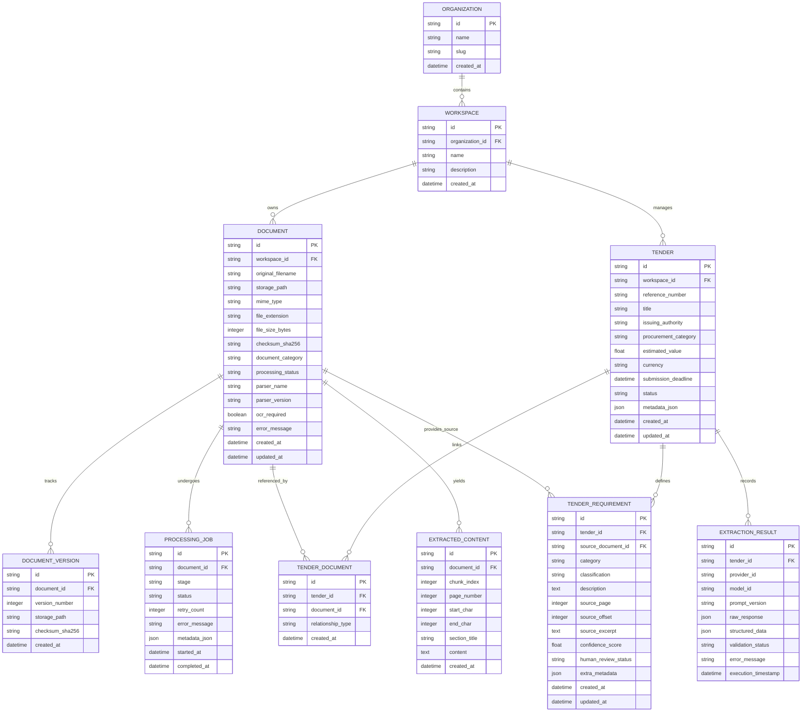

# TenderForge — Phase 0: Data Model & Schema Design

## 1. Overview & Principles

The TenderForge data model is designed using SQLAlchemy 2.0 declarative models with support for SQLite (development/testing) and PostgreSQL (production). 

Core design principles:
- **UUID Primary Keys**: Eliminates enumeration vulnerabilities and supports distributed generation.
- **Strict Timestamps & Auditing**: Every record tracks `created_at` and `updated_at` (UTC).
- **Source Traceability (ProofLink Ready)**: Extracted requirements always maintain a foreign key to their source document, page number, character offset, and supporting verbatim text.
- **Tenant Isolation**: Entities are partitioned under a `workspace_id` or `organization_id` to prepare for future enterprise multi-tenancy.
- **Zero Secrets in Database**: Configuration references store provider identifiers and model names, never raw API keys or passwords.

---

## 2. Entity-Relationship Diagram

---

## 3. Entity Definitions & Attribute Specifications

### 3.1 Document Entity (`documents`)
Represents an uploaded file artifact within a workspace.
- `id` (VARCHAR(36), PK): UUID v4.
- `workspace_id` (VARCHAR(36), FK): Reference to owning workspace.
- `original_filename` (VARCHAR(255), NOT NULL): Client-supplied filename (sanitized for display).
- `storage_path` (VARCHAR(512), NOT NULL): Absolute or relative filesystem/object path where the actual binary is safely stored.
- `mime_type` (VARCHAR(128), NOT NULL): Verified MIME type.
- `file_extension` (VARCHAR(16), NOT NULL): Normalized extension (`.pdf`, `.docx`, etc.).
- `file_size_bytes` (INTEGER, NOT NULL): File size in bytes.
- `checksum_sha256` (VARCHAR(64), NOT NULL, INDEX): Cryptographic digest for duplicate detection.
- `document_category` (VARCHAR(64)): Category (`tender_notice`, `technical_rfp`, `financial_boq`, `evidence_cert`, `other`).
- `processing_status` (VARCHAR(32), NOT NULL, DEFAULT 'pending'): Status (`pending`, `processing`, `parsed`, `failed`).
- `parser_name` (VARCHAR(64)): Name of the parser used (`PyMuPDFParser`, `DocxParser`, etc.).
- `parser_version` (VARCHAR(32)): Version string of the parser adapter.
- `ocr_required` (BOOLEAN, DEFAULT FALSE): Flag set to true if document is scanned or lacks text.
- `error_message` (TEXT): Diagnostic message if extraction failed.
- `created_at` (DATETIME, NOT NULL): UTC creation timestamp.
- `updated_at` (DATETIME, NOT NULL): UTC last updated timestamp.

### 3.2 ProcessingJob Entity (`processing_jobs`)
Tracks asynchronous and synchronous parsing/extraction job stages.
- `id` (VARCHAR(36), PK): UUID v4.
- `document_id` (VARCHAR(36), FK, NOT NULL): Target document.
- `stage` (VARCHAR(64), NOT NULL): Stage (`validation`, `parsing`, `normalization`, `segmentation`, `intelligence_extraction`).
- `status` (VARCHAR(32), NOT NULL): `queued`, `in_progress`, `completed`, `failed`.
- `retry_count` (INTEGER, DEFAULT 0).
- `error_message` (TEXT).
- `metadata_json` (JSON).
- `started_at` (DATETIME).
- `completed_at` (DATETIME).

### 3.3 ExtractedContent Entity (`extracted_contents`)
Holds normalized text segments (chunks) with exact source coordinates for search, embeddings, and prompt construction.
- `id` (VARCHAR(36), PK): UUID v4.
- `document_id` (VARCHAR(36), FK, NOT NULL): Source document.
- `chunk_index` (INTEGER, NOT NULL): Zero-based sequential order.
- `page_number` (INTEGER): Source page number (1-indexed) or sheet index.
- `start_char` (INTEGER): Character offset in original text.
- `end_char` (INTEGER): Character offset end.
- `section_title` (VARCHAR(255)): Heading context if detected.
- `content` (TEXT, NOT NULL): Normalized textual content.
- `created_at` (DATETIME, NOT NULL).

### 3.4 Tender Entity (`tenders`)
Represents the procurement opportunity being responded to.
- `id` (VARCHAR(36), PK): UUID v4.
- `workspace_id` (VARCHAR(36), FK, NOT NULL): Owning workspace.
- `reference_number` (VARCHAR(128), INDEX): Official tender number (e.g. `RFP-2026-GOV-091`).
- `title` (VARCHAR(512), NOT NULL): Tender title.
- `issuing_authority` (VARCHAR(255)): Government or corporate issuer.
- `procurement_category` (VARCHAR(128)): E.g., Goods, Services, IT Infrastructure, Works.
- `estimated_value` (FLOAT): Numerical value if stated.
- `currency` (VARCHAR(8), DEFAULT 'USD'): ISO 4217 code.
- `submission_deadline` (DATETIME): Submission cutoff date/time.
- `status` (VARCHAR(32), NOT NULL, DEFAULT 'draft'): `draft`, `analyzing`, `analyzed`, `in_review`.
- `metadata_json` (JSON): Additional extracted or user-supplied metadata.
- `created_at` (DATETIME, NOT NULL).
- `updated_at` (DATETIME, NOT NULL).

### 3.5 TenderRequirement Entity (`tender_requirements`)
Represents an individual extracted requirement with auditable ProofLink references.
- `id` (VARCHAR(36), PK): UUID v4.
- `tender_id` (VARCHAR(36), FK, NOT NULL): Parent tender.
- `source_document_id` (VARCHAR(36), FK, NOT NULL): Document from which the requirement was derived.
- `category` (VARCHAR(64), NOT NULL): `eligibility`, `technical`, `financial`, `submission`, `general`.
- `classification` (VARCHAR(32), NOT NULL, DEFAULT 'mandatory'): `mandatory`, `optional`, `desirable`.
- `description` (TEXT, NOT NULL): Standardized requirement statement.
- `source_page` (INTEGER): Document page number.
- `source_offset` (INTEGER): Character offset.
- `source_excerpt` (TEXT, NOT NULL): Verbatim citation from original document.
- `confidence_score` (FLOAT, DEFAULT 1.0): Model confidence between 0.0 and 1.0.
- `human_review_status` (VARCHAR(32), DEFAULT 'unreviewed'): `unreviewed`, `confirmed`, `rejected`, `modified`.
- `extra_metadata` (JSON): Configurable key-values.

### 3.6 ExtractionResult Entity (`extraction_results`)
Preserves complete raw and validated AI extraction payloads for reproducibility and auditability.
- `id` (VARCHAR(36), PK): UUID v4.
- `tender_id` (VARCHAR(36), FK, NOT NULL): Target tender.
- `provider_id` (VARCHAR(64), NOT NULL): AI provider identifier (`openai`, `gemini`, `ollama`, `mock`).
- `model_id` (VARCHAR(128), NOT NULL): Model name (e.g., `gpt-4o`, `gemini-1.5-pro`).
- `prompt_version` (VARCHAR(32), NOT NULL): Version tag of prompt template used.
- `raw_response` (JSON): Raw provider response payload.
- `structured_data` (JSON): Schema-validated output payload.
- `validation_status` (VARCHAR(32), NOT NULL): `valid`, `invalid`, `fallback_used`, `ai_configuration_required`.
- `error_message` (TEXT).
- `execution_timestamp` (DATETIME, NOT NULL).

---

## 4. Indexing & Migration Strategy

- **Indexes**:
  - `documents(checksum_sha256)`: Accelerates duplicate ingestion checks.
  - `documents(workspace_id, processing_status)`: Optimizes listing and queue management.
  - `extracted_contents(document_id, chunk_index)`: Rapid retrieval of segmented text in sequential order.
  - `tender_requirements(tender_id, category)`: Fast filtering by requirement categories.
  - `tenders(workspace_id, reference_number)`: Quick search by tender number.
- **Alembic**: Initial migration scripts will establish all tables, constraints, foreign keys, and indexes declaratively.

