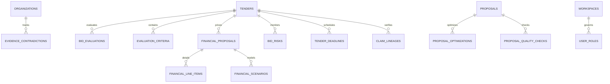

# TenderForge Phase 3 Data Model & Database Migration

## 1. Overview & Evolution

Phase 3 introduces 12 new relational entities to support Bid/No-Bid Intelligence, Advanced ProofLink, Financial Proposals, Evaluation Optimization, Bid Risks, Deadlines, and RBAC.

All migrations are tracked and executed deterministically via Alembic:
- `001_initial_schema`: Documents, Workspaces, Organizations, Tenders, Requirements.
- `002_phase2_models`: Evidence, ProofLink links, Compliance, Proposals, Audits, Approvals, Switch Rooms.
- `003_phase3_models`: BidEvaluations, Contradictions, ClaimLineages, Criteria, Optimizations, Financials, Risks, Deadlines, UserRoles.

---

## 2. Entity-Relationship Diagram

---

## 3. Phase 3 Table Reference

1. `bid_evaluations`: Dimensions, weights, overall score, eligibility gates, recommendation, conditions, executive summary, human decision.
2. `evidence_contradictions`: Organization ID, evidence references, claim field, value 1, value 2, severity, resolution notes.
3. `claim_lineages`: Complete cryptographic path `Requirement -> Evidence -> Extract -> Claim -> Review -> Approved Section`, SHA-256 hash.
4. `evaluation_criteria`: Criterion code, category, weights, maximum marks, scoring rubrics.
5. `proposal_optimizations`: Proposal ID, criterion ID, section, coverage status, gap analysis, Before text, After text.
6. `financial_proposals`: Subtotal, overhead, contingency, margin, tax, grand total, currency, status.
7. `financial_line_items`: Item code, description, category, unit, quantity, unit rate, tax percent, line total.
8. `financial_scenarios`: Base Case, Conservative, Aggressive scenario totals and margins.
9. `bid_risks`: Likelihood, impact, severity score (1-25), risk level, mitigation strategy, owner, status.
10. `proposal_quality_checks`: Formatting score, placeholder count, citations verified, word count, pass/fail status.
11. `tender_deadlines`: Milestone type, date, timezone, reminder hours, notification timestamps.
12. `user_roles`: Workspace-scoped RBAC roles (`Viewer`, `Author`, `Reviewer`, `Approver`, `Admin`).
