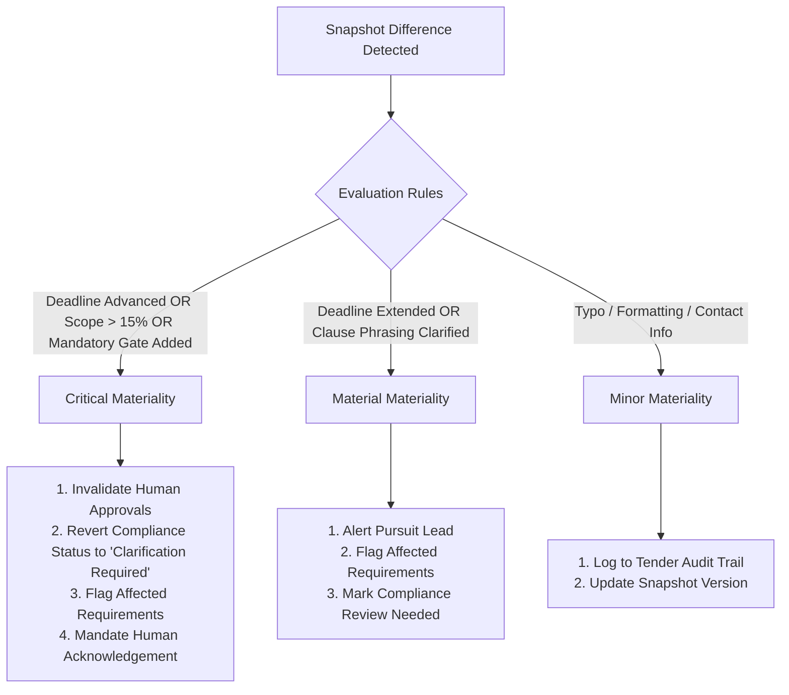

# Phase 5: Amendment & Impact Intelligence — Automated Corrigendum Analysis

## 1. Overview

When an issuing authority publishes a corrigendum or addendum, the alterations can affect multiple internal workflows: technical specifications may be obsolete, mandatory delivery timelines may have shifted, or compliance criteria may have changed.

TenderForge's **Amendment & Impact Intelligence Engine** classifies amendments by materiality, maps affected clauses, and propagates downstream state changes across requirements, compliance matrices, proposal sections, and human approvals.

---

## 2. Materiality Classification Tiers

TenderForge categorizes amendments into three strict materiality levels:



### 2.1 Critical Materiality
- **Trigger Conditions**:
  - `deadline_changed`: Submission deadline advanced (moved earlier).
  - Scope expansion or contract value change $>15\%$.
  - Addition of new mandatory eligibility conditions or statutory penalties.
- **System Impact**:
  - Automatically transitions `HumanApproval` records from `Approved` to `Changes Requested`.
  - Appends audit notice: *"Approval invalidated due to Critical Corrigendum [Number]: [Title]. Executive re-authorization required before submission."*
  - Reverts `ComplianceMatrix.overall_status` to `"Clarification Required"`.

### 2.2 Material Materiality
- **Trigger Conditions**:
  - `deadline_changed`: Submission deadline extended (moved later).
  - Bill of Quantities (BOQ) adjustments or technical specification revisions.
  - Evaluation criteria weight alterations.
- **System Impact**:
  - Flags affected `TenderRequirement` records with amendment impact descriptions.
  - Flags `ComplianceMatrix` for review without immediate invalidation of executive approval.

### 2.3 Minor Materiality
- **Trigger Conditions**:
  - Clarification of pre-bid meeting venue or virtual link.
  - Formatting corrections, typo fixes, or buyer contact email updates.
- **System Impact**:
  - Recorded in the audit log; no active workflow disruption.

---

## 3. Downstream Impact Propagation Algorithm

When `AmendmentService.record_amendment()` executes:

1. **Clause Keyword Matcher**:
   Iterates over `affected_clauses`. For each clause keyword, searches active `TenderRequirement` records:
   ```python
   for req in requirements:
       if clause_kw in req.description.lower() or clause_kw in req.source_excerpt.lower():
           downstream_impact["affected_requirements"].append({
               "id": req.id,
               "description": req.description[:100],
               "impact": clause.get("description"),
           })
   ```

2. **Compliance Flagging**:
   Flags the active `ComplianceMatrix` with:
   - `overall_status = "Clarification Required"`
   - `summary = f"Flagged for reassessment due to Amendment {amendment_number}."`

3. **Approval Invalidation**:
   If materiality is `critical`, iterates over existing `HumanApproval` records:
   - `approval.decision = "Changes Requested"`
   - `approval.comments += f" | Approval invalidated due to Critical Corrigendum {amendment_number}."`
   - `downstream_impact["approval_invalidated"] = True`

4. **Human Acknowledgement Gate**:
   The tender is blocked from final submission until a designated pursuit manager or technical architect calls `acknowledge_amendment()`, certifying that the changes have been reviewed and incorporated into the proposal draft.

