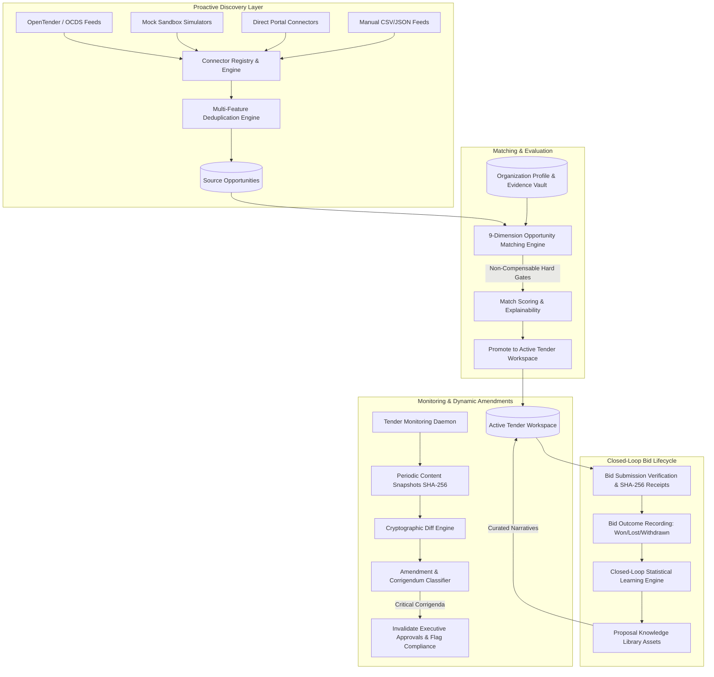

# Phase 5: Architecture Overview — Proactive Procurement Intelligence, Discovery & Closed-Loop Learning

## 1. Executive Summary

Phase 5 elevates TenderForge from a reactive, tender-by-tender proposal generation tool into an end-to-end, proactive procurement intelligence platform. TenderForge continuously discovers procurement notices from external feeds, deduplicates opportunities across portals, performs multi-dimensional eligibility matching against organization capabilities, monitors active tenders for corrigenda with downstream impact propagation, and closes the learning loop from final contract outcomes into reusable organizational proposal assets.

---

## 2. Core Architectural Pillars

### 2.1 Pluggable Procurement Connector Framework
- **Registry Pattern**: Concrete connectors inherit from `BaseProcurementConnector` and register with `ProcurementConnectorRegistry`.
- **SSRF Protection & Protocol Validation**: Enforces HTTPS/HTTP boundaries, blocks localhost/link-local endpoints (`127.0.0.1`, `169.254.169.254`, `::1`), and validates rate-limiting intervals.
- **Connectors Provided**:
  - `ManualConnector`: Parses structured batches of tender records (JSON/CSV) with schema verification.
  - `OpenTenderConnector`: Ingests standardized Open Contracting Data Standard (OCDS) release packages.
  - `MockSandboxConnector`: High-fidelity multi-sector simulated tender stream with realistic qualification requirements for testing and sandbox environments.

### 2.2 Multi-Feature Opportunity Deduplication & Reconciliation
- **Candidate Clustering**: Fast blocking on normalized tender reference numbers, canonical URLs, and normalized issuing authority keys.
- **Fuzzy Token Matching**: SequenceMatcher similarity over normalized procurement titles ($T \ge 0.88$).
- **Discrepancy Resolution**: When multiple portals report different deadlines or budget estimates for the same tender, TenderForge creates a linked cluster, updates provenance, and surfaces audit flags for human review.

### 2.3 9-Dimension AI Opportunity Matching & Non-Compensable Hard Gates
- Evaluates alignment between organization profile, financial metrics, certifications, and past performance artifacts against tender requirements across 9 dimensions:
  1. Mandatory Qualification Gates (Non-compensable: score capped at 48.0 upon gate failure)
  2. Technical & Domain Alignment
  3. Past Performance & Verified Case Studies
  4. Financial Capacity & Turnover Ratios
  5. Resource Availability Benchmark
  6. Geographic Alignment & Regional Jurisdiction
  7. Buyer Relationship & Past Contract History
  8. Strategic Fit
  9. Risk vs. Runway Horizon
- Outputs transparent explainability breakdown: Strengths, Weaknesses, Uncertainties, Gate Failures, and Missing Evidence Artifacts.

### 2.4 Continuous Tender Monitoring & Corrigendum Intelligence
- Periodic polling of issuing sources and tender portals based on configurable interval tiers (Standard, Critical, Urgent).
- Cryptographic SHA-256 content snapshots track every revision.
- Automated materiality classification:
  - **Minor**: Typographical or phrasing adjustments ($<5\%$ scope variance).
  - **Material**: Submission date extensions, clause clarifications, non-critical BOQ updates.
  - **Critical**: Submission deadline advanced, scope expansions $>15\%$, budget alterations, or mandatory eligibility amendments.
- Downstream impact propagation:
  - Invalidates preliminary executive approvals (status transitioned to `Changes Requested`).
  - Flags compliance matrix for re-audit (`Clarification Required`).
  - Identifies affected proposal sections and mandates human acknowledgement before submission.

### 2.5 Market & Competitor Intelligence
- **Public Award Registry**: Aggregates verified public procurement awards (`AwardRecord`) with buyer, category, contract value, and winner details.
- **Competitor Benchmarking**: Discovers frequent competitors, tracks historical win rates, and estimates typical discount patterns.
- **Tenant Isolation**: Public intelligence is strictly isolated from proprietary customer proposal data. Competitor records only reference verified external public data, never cross-tenant workspace submissions.

### 2.6 14-Stage Bid Lifecycle & Submission Verification
- Complete audit trail tracking a pursuit through 14 standardized lifecycle stages:
  1. `discovered`
  2. `evaluating`
  3. `pursuit_approved`
  4. `pursuit_declined`
  5. `in_preparation`
  6. `compliance_cleared`
  7. `internal_approved`
  8. `submitted_to_buyer`
  9. `under_buyer_evaluation`
  10. `shortlisted`
  11. `clarification_requested`
  12. `awarded_won`
  13. `awarded_lost`
  14. `withdrawn`
- Generates immutable SHA-256 cryptographic submission receipts capturing timestamp, tender reference, financial total, submitting authority, and file hash.

### 2.7 Closed-Loop Statistical Learning & Knowledge Library
- Captures root-cause loss reasons (`price_too_high`, `non_compliant_technical`, `lacking_experience`, `incumbent_advantage`, `administrative_defect`) and winning differentiators.
- Enforces statistical significance threshold ($N \ge 5$) before generating automated predictive adjustments.
- Organization Knowledge Asset library (`KnowledgeAsset`, `KnowledgeAssetVersion`) enables cross-bid reuse of vetted technical narratives, methodology descriptions, and compliance certifications with lifecycle status controls.

---

## 3. Technology Stack Alignment

| Component | Implementation | Location |
| :--- | :--- | :--- |
| **Backend Framework** | FastAPI, Python 3.14, Pydantic v2 | `backend/app/` |
| **Database ORM** | SQLAlchemy 2.0 with SQLite / PostgreSQL | `backend/app/infrastructure/database/` |
| **Migrations** | Alembic (Migration `005_phase5_procurement_intelligence`) | `backend/alembic/versions/` |
| **Agent Integration** | Switch Room Protocol & Tool Catalog | `backend/app/integrations/switch/` |
| **Configuration** | YAML Configuration (`config/*.yaml`) | `config/` |
| **Frontend** | React, TypeScript, Tailwind CSS | `frontend/src/App.tsx`, `frontend/dist/` |
