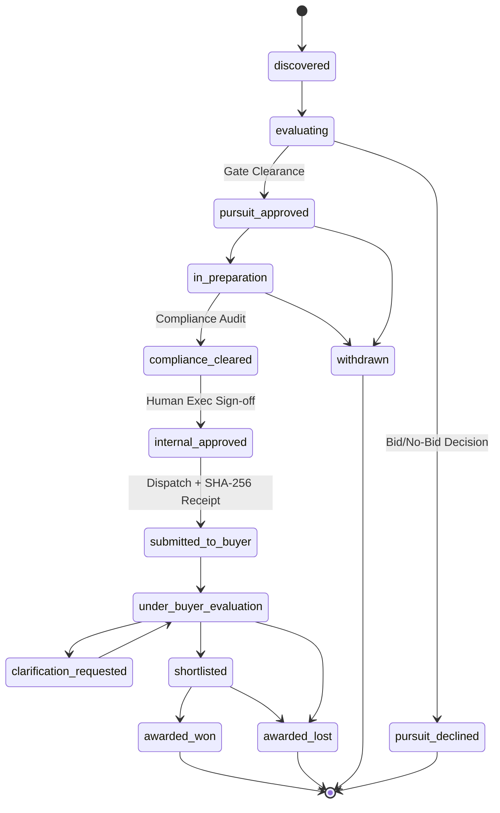

# Phase 5: 14-Stage Bid Lifecycle & Cryptographic Submission Verification

## 1. Overview

Responding to major tenders involves complex internal governance across multidisciplinary teams. Without a rigorous lifecycle, bids risk late submissions, missing compliance sign-offs, or disputes regarding what exact proposal version was delivered to the buyer.

TenderForge enforces a **14-stage bid lifecycle** and generates **cryptographic SHA-256 submission receipts** upon final proposal dispatch.

---

## 2. 14-Stage Lifecycle Progression



---

## 3. Cryptographic Submission Receipt Generation

When a proposal is officially submitted to the issuing buyer, TenderForge records an immutable `BidSubmissionRecord`:

```python
class BidSubmissionRecord(Base):
    __tablename__ = "bid_submission_records"

    id = Column(String(36), primary_key=True)
    tender_id = Column(String(36), ForeignKey("tenders.id"))
    organization_id = Column(String(36), ForeignKey("organizations.id"))
    submission_timestamp = Column(DateTime, nullable=False)
    submission_receipt_hash = Column(String(64), nullable=False) # SHA-256
    final_bid_amount = Column(Float, nullable=False)
    currency = Column(String(8), default="USD")
    submitted_by_user_id = Column(String(128), nullable=False)
    lifecycle_stage = Column(String(64), default="submitted_to_buyer")
    submission_artifacts = Column(JSON) # File hashes & dispatch metadata
    notes = Column(Text)
```

### Receipt Hash Formulation:
$$\text{Receipt Hash} = \text{SHA-256}(\text{TenderID} \parallel \text{OrgID} \parallel \text{TimestampISO} \parallel \text{Amount} \parallel \text{UserID} \parallel \text{ArtifactDigests})$$

This cryptographic digest serves as tamper-evident proof of the exact submission moment, financial figure, and document versions authorized by the enterprise.

---

## 4. Human Authority & Anti-Hallucination Guarantees

AI agents can draft, audit, calculate compliance scores, and suggest narrative improvements, but **AI agents are strictly forbidden from executing bid submission or signing off on proposal delivery**.

The `record_bid_submission` API enforces that `submitted_by_user_id` corresponds to an authenticated human user with pursuit authorization rights (`BidManager` or `Approver` role).

