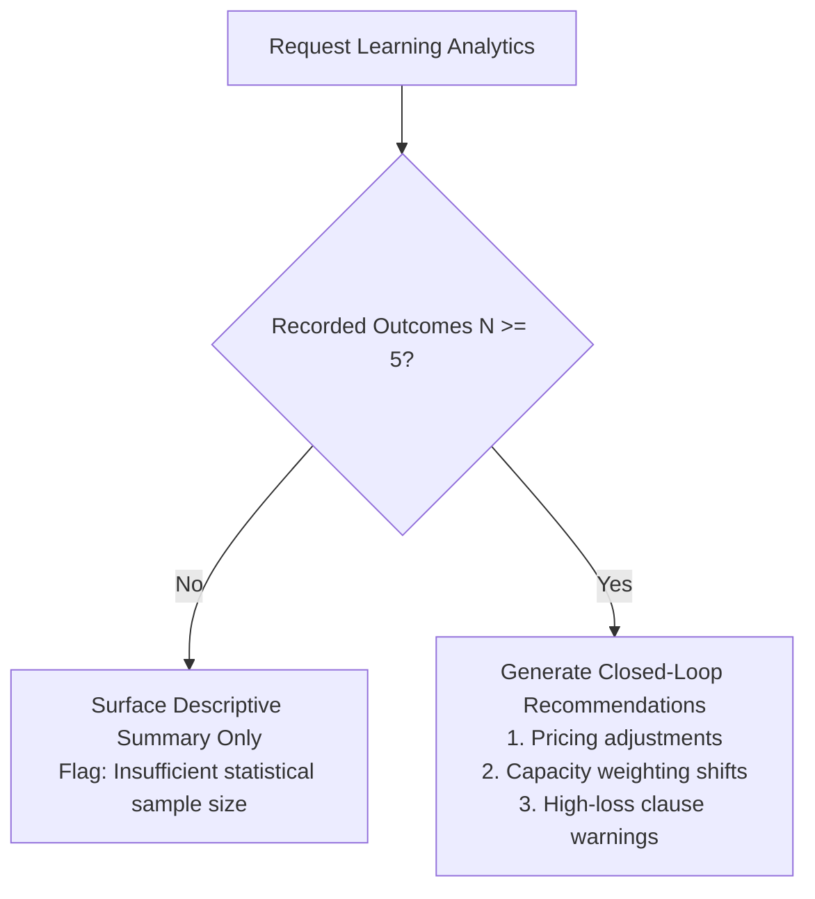

# Phase 5: Closed-Loop Bid Learning & Outcome Intelligence

## 1. Overview

In most organizations, bid feedback and post-submission learnings are lost after tender award. Teams rarely systematically analyze why proposals won or lost, leading to repeated errors in pricing, compliance, or technical positioning.

TenderForge's **Closed-Loop Bid Learning Engine** captures structured outcome intelligence, analyzes root causes, and feeds actionable statistical insights back into future bid evaluations and knowledge assets.

---

## 2. Structured Outcome Capture

When a tender concludes, a `BidOutcomeRecord` is logged:

```python
class BidOutcomeRecord(Base):
    __tablename__ = "bid_outcome_records"

    id = Column(String(36), primary_key=True)
    submission_id = Column(String(36), ForeignKey("bid_submission_records.id"), unique=True)
    outcome = Column(String(32), nullable=False) # 'won', 'lost', 'withdrawn', 'cancelled_by_buyer'
    winning_bidder = Column(String(255))
    winning_amount = Column(Float)
    price_variance_pct = Column(Float)
    loss_reasons = Column(JSON)      # Categorized loss codes
    win_factors = Column(JSON)       # Categorized win codes
    debrief_notes = Column(Text)     # Formal post-tender debrief notes
    debrief_date = Column(DateTime)
```

### Standardized Loss & Win Codes
- **Loss Reasons**: `price_too_high`, `non_compliant_technical`, `lacking_experience`, `incumbent_advantage`, `administrative_defect`, `timeline_unrealistic`.
- **Win Factors**: `highest_technical_score`, `lowest_commercial_price`, `superior_slas`, `robust_knowledge_asset_reuse`, `past_buyer_relationship`.

---

## 3. Statistical Significance Threshold ($N \ge 5$)

A critical engineering design rule in TenderForge is preventing over-fitting or wild algorithmic swings based on a single outlier tender.



- When $N < 5$: TenderForge presents raw debrief notes, counts, and win/loss totals with an explicit warning:
  *"Sample size (N={N}) is below statistical significance threshold (5). Systematic automated weight modifications are deferred."*
- When $N \ge 5$: The engine computes:
  - Empirical Win Rate: $\frac{N_{\text{won}}}{N_{\text{total}}}$
  - Average Price Variance against winners on losses.
  - Frequency distribution of root-cause loss reasons.
  - Actionable recommendations (e.g. *"Price was cited as primary loss reason in 60% of bids. Recommend lowering commercial margins on QCBS tenders where financial weighting exceeds 30%."*).

---

## 4. Re-Injection into Bid/No-Bid and Knowledge Assets

Insights flow directly back into the early pipeline:
1. **Opportunity Matching**: If past outcomes show consistent technical rejections in a specific sub-category (e.g. mainframe hosting), technical capability weighting in that category is penalized until new credentials are added to the Evidence Vault.
2. **Knowledge Asset Lifecycle**: Narrative assets used in winning proposals receive positive reuse scores and priority ranking, while assets associated with technical non-compliance flags are marked for editorial revision.

