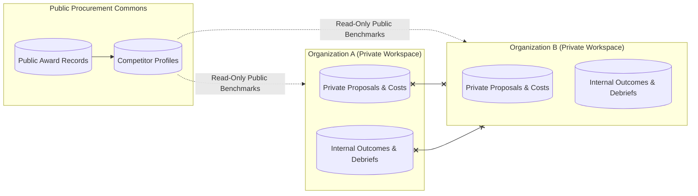

# Phase 5: Competitor Intelligence & Benchmarks

## 1. Overview

Understanding competitor positioning, win probabilities, and pricing strategies enables pursuit teams to tailor technical differentiators and optimize financial bids.

TenderForge provides **tenant-isolated competitor intelligence** compiled strictly from publicly disclosed tender awards and verified bid openings.

---

## 2. Competitor Model & Attributes

The `CompetitorRecord` model maintains profiles of competing suppliers:

```python
class CompetitorRecord(Base):
    __tablename__ = "competitor_records"

    id = Column(String(36), primary_key=True)
    name = Column(String(255), unique=True, index=True)
    known_aliases = Column(JSON)             # Alternative trading names & subsidiary designations
    primary_categories = Column(JSON)        # e.g., ['information_technology', 'cloud']
    estimated_win_rate = Column(Float)       # Empirical win rate from recorded awards
    typical_discount_pct = Column(Float)     # Average % below ceiling price
    strengths = Column(JSON)                 # Observed technical advantages
    weaknesses = Column(JSON)                # Observed delivery gaps or audit flags
    public_award_count = Column(Integer)     # Number of verified contract awards
    notes = Column(Text)
```

---

## 3. Strict Tenant Isolation Principles



- **No Cross-Tenant Leakage**: An organization’s private proposals, pricing models, win/loss debriefs, and margin details are strictly scoped to their tenant.
- **No Reverse Engineering**: Competitor win rates and discounts are derived strictly from public gazette awards (`AwardRecord`), never from other TenderForge subscribers' private workspaces.

---

## 4. Benchmark Derivations

When assessing competitors in a category:
- **Win Rate Calculation**:
  $$\text{Win Rate} = \frac{\text{Awards Won by Competitor } C \text{ in Category}}{\text{Total Bids in Category Involving } C}$$
- **Discount Modeling**:
  Tracks standard deviation of competitor bids relative to published estimates, informing whether a given competitor bids aggressively on price or commands a premium on technical reputation.
- **Differentiation In Proposals**:
  Enables the `ProposalArchitect` agent to emphasize unique differentiators (e.g. higher SLAs, dedicated local support) when competing against specific known rivals.
