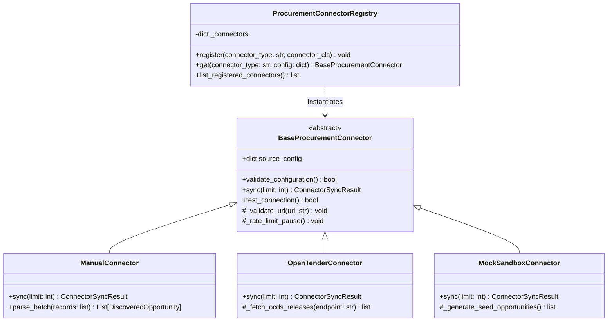

# Phase 5: Procurement Connector Framework & Integration Guide

## 1. Overview

The TenderForge Connector Framework provides an extensible, secure, and resilient abstraction layer for communicating with external procurement portals, government gazettes, and electronic bidding systems.

Every connector adheres to the `BaseProcurementConnector` interface, ensuring uniform authentication, error handling, rate limiting, and output data normalization.

---

## 2. Architecture & Class Hierarchy



---

## 3. Data Transfer Objects

### 3.1 `DiscoveredOpportunity`
Every external record is mapped to a canonical `DiscoveredOpportunity` model before entering the deduplication and matching pipeline:

```python
class DiscoveredOpportunity(BaseModel):
    external_id: str                      # Remote portal's unique identifier
    title: str                            # Tender procurement title
    buyer_name: str                       # Contracting entity / authority
    procurement_category: str             # e.g., 'information_technology', 'healthcare'
    estimated_budget: Optional[float]     # Cleaned numeric valuation in tender currency
    currency: str = "USD"                 # ISO 4217 currency code
    published_date: Optional[datetime]    # Release timestamp (UTC)
    submission_deadline: Optional[datetime] # Final submission cutoff (UTC)
    status: str = "open"                  # 'open', 'closed', 'cancelled'
    opportunity_url: Optional[str]        # Direct link to procurement portal
    canonical_summary: Optional[str]      # Cleaned textual scope description
    raw_payload: Dict[str, Any]           # Full raw JSON payload preserving portal artifacts
```

### 3.2 `ConnectorSyncResult`
Returns execution telemetry for ingestion tracking:
```python
class ConnectorSyncResult(BaseModel):
    opportunities: List[DiscoveredOpportunity]
    fetched_count: int
    new_count: int
    updated_count: int
    duplicate_count: int
    errors: List[str]
```

---

## 4. Built-in Connector Implementations

### 4.1 `ManualConnector` (`manual`)
- **Use Case**: Offline bulk imports, spreadsheet data dumps, and internal enterprise RFPs.
- **Input**: JSON arrays or CSV files containing procurement notices.
- **Parsing**: Performs date normalization, currency symbol stripping, and schema validation.

### 4.2 `OpenTenderConnector` (`open_tender`)
- **Use Case**: Standardized public procurement data adhering to the Open Contracting Data Standard (OCDS 1.1).
- **Features**:
  - Traverses `releases` array.
  - Extracts `tender.id`, `tender.title`, `tender.description`, `tender.value.amount`, `tender.tenderPeriod.endDate`, and buyer parties.
  - Automatically handles pagination links and header authentication tokens.

### 4.3 `MockSandboxConnector` (`mock_sandbox`)
- **Use Case**: Safe offline demonstration, developer onboarding, testing environments, and hackathon simulations.
- **Features**:
  - Deterministically generates high-value public procurement notices across three distinct domains:
    1. Cloud Infrastructure & Kubernetes Modernization ($4.85M)
    2. Healthcare Interoperable EHR Platform ($12.5M)
    3. Municipal Smart Grid & Water Metering Automation ($8.2M)
  - Prepopulates realistic evaluation criteria, QCBS selection methods, and specific mandatory eligibility gates.

---

## 5. Security & SSRF Protection

All connectors inherit mandatory SSRF protection via `_validate_url`:

```python
FORBIDDEN_HOSTS = ["localhost", "127.0.0.1", "::1", "169.254.169.254", "0.0.0.0"]

def _validate_url(self, url: str) -> None:
    parsed = urllib.parse.urlparse(url)
    if parsed.scheme not in ("http", "https"):
        raise ValueError(f"Insecure protocol '{parsed.scheme}'. Only HTTP/HTTPS allowed.")
    if parsed.hostname in FORBIDDEN_HOSTS or parsed.hostname.endswith(".internal"):
        raise ValueError(f"SSRF violation: Host '{parsed.hostname}' is prohibited.")
```

---

## 6. Registering a Custom Connector

To register a new enterprise procurement portal:

```python
from backend.app.integrations.procurement.base_connector import BaseProcurementConnector, ConnectorSyncResult
from backend.app.integrations.procurement.connector_registry import connector_registry

class CustomGovPortalConnector(BaseProcurementConnector):
    def validate_configuration(self) -> bool:
        return bool(self.source_config.get("api_key"))

    async def sync(self, limit: int = 50) -> ConnectorSyncResult:
        # Fetch remote records, map to DiscoveredOpportunity, and return ConnectorSyncResult
        ...

connector_registry.register("custom_gov_portal", CustomGovPortalConnector)
```
