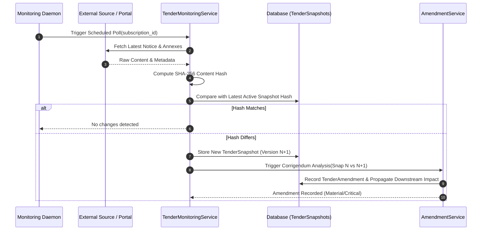

# Phase 5: Continuous Tender Monitoring & Version Snapshots

## 1. Overview

Tender specifications, dates, technical annexes, and qualification terms are rarely static. Issuing authorities frequently publish corrigenda, addenda, and Q&A clarifications throughout the bidding window. Missing a single corrigendum can lead to technical rejection or non-responsive disqualification.

TenderForge provides **automated continuous monitoring with cryptographic version snapshots**.

---

## 2. Monitoring Workflow



---

## 3. Subscription & Snapshot Data Models

### 3.1 `TenderMonitorSubscription`
- Represents an active monitoring watch on an engaged tender.
- Tracks:
  - `tender_id`, `organization_id`, `procurement_source_id`
  - `poll_interval_hours`: Frequency of inspection (configurable: Standard 24h, Critical 6h, Urgent 1h).
  - `last_checked_at`, `last_snapshot_at`, `status` (`active`, `paused`, `error`).

### 3.2 `TenderSnapshot`
- Stores an immutable point-in-time state of the tender documentation.
- Fields:
  - `snapshot_version`: Sequential integer ($1, 2, 3, \dots$).
  - `content_hash`: Cryptographic SHA-256 digest of normalized tender text.
  - `metadata_json`: Key attributes including deadline, budget, and contact info.
  - `raw_content`: Preserved baseline text for line-by-line diffing.

---

## 4. Cryptographic Hash Calculation

To prevent false positives from transient whitespace, formatting, or HTML cookie headers, content is normalized prior to hashing:

```python
def compute_snapshot_hash(content: str, metadata: Dict[str, Any]) -> str:
    # 1. Normalize line breaks and trim extraneous whitespace
    cleaned = re.sub(r"\s+", " ", content).strip()
    
    # 2. Extract deterministic core metadata keys
    meta_keys = ["submission_deadline", "estimated_value", "procurement_category", "issuing_authority"]
    meta_digest = "|".join(f"{k}:{metadata.get(k)}" for k in meta_keys)
    
    # 3. Compute SHA-256
    payload = f"{cleaned}###{meta_digest}".encode("utf-8")
    return hashlib.sha256(payload).hexdigest()
```

---

## 5. Polling Policies & Schedule

Defined in `config/monitoring_policies.yaml`:
- **Standard Watch**: Check once every 24 hours.
- **Approaching Deadline ($\le 7$ days)**: Escalates automatically to every 4 hours.
- **Corrigendum Active ($\le 72$ hours after notice)**: Hourly verification.

