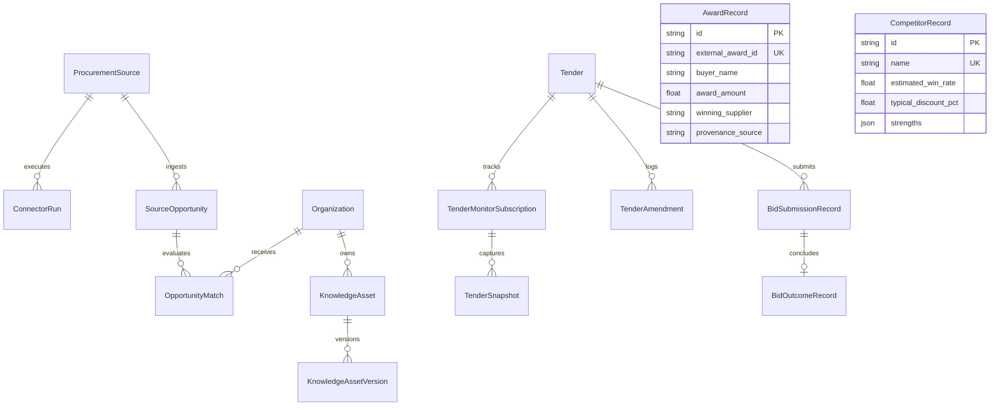

# Phase 5: Data Models & Database Migrations

## 1. Overview

Phase 5 extends TenderForge's persistence schema by introducing **12 new relational entities** supporting automated discovery, continuous monitoring, market analytics, submission verification, and organizational knowledge reuse.

The changes are tracked under Alembic migration:
`backend/alembic/versions/005_phase5_procurement_intelligence.py`.

---

## 2. Entity-Relationship Model



---

## 3. Detailed Table Definitions

### 3.1 `procurement_sources` & `connector_runs`
- `procurement_sources`: Stores external feed endpoints, credentials, poll intervals, and connector types (`manual`, `open_tender`, `mock_sandbox`).
- `connector_runs`: Tracks execution history, status (`running`, `completed`, `failed`), opportunities fetched, and runtime errors.

### 3.2 `source_opportunities` & `opportunity_matches`
- `source_opportunities`: Deduplicated tender notices across public portals. Indexed on `(external_id, procurement_source_id)` and `submission_deadline`.
- `opportunity_matches`: Stores 9-dimension scoring results, overall score, mandatory gates status, recommendation tier, and explainability JSON.

### 3.3 `tender_monitor_subscriptions`, `tender_snapshots` & `tender_amendments`
- `tender_monitor_subscriptions`: Connects an active `Tender` with an external source for periodic polling.
- `tender_snapshots`: Immutable content snapshots with SHA-256 hashes (`content_hash`).
- `tender_amendments`: Corrigenda records with `materiality` (`minor`, `material`, `critical`), `diff_summary`, `affected_clauses`, `downstream_impact`, and `approval_invalidated`.

### 3.4 `award_records` & `competitor_records`
- `award_records`: Public procurement awards with verified buyers, contract values, winners, and provenance.
- `competitor_records`: Competitor profiles with empirical win rates, discount percentages, and observed strengths/weaknesses.

### 3.5 `bid_submission_records` & `bid_outcome_records`
- `bid_submission_records`: 14-stage bid lifecycle tracker with `submission_receipt_hash` (SHA-256), final commercial amount, and submitting user ID.
- `bid_outcome_records`: Final award outcomes (`won`, `lost`, `withdrawn`), winning bidder, price variance, loss reasons, and debrief notes.

### 3.6 `knowledge_assets` & `knowledge_asset_versions`
- `knowledge_assets`: Reusable proposal narrative catalog with `times_reused` counter and `lifecycle_status`.
- `knowledge_asset_versions`: Version history with Markdown narrative content and human approver verification metadata.

---

## 4. Applying & Rollback of Migrations

- **Apply Migration**:
  ```powershell
  alembic -c backend/alembic.ini upgrade head
  ```
- **Rollback to Phase 4 Baseline**:
  ```powershell
  alembic -c backend/alembic.ini downgrade 004
  ```

