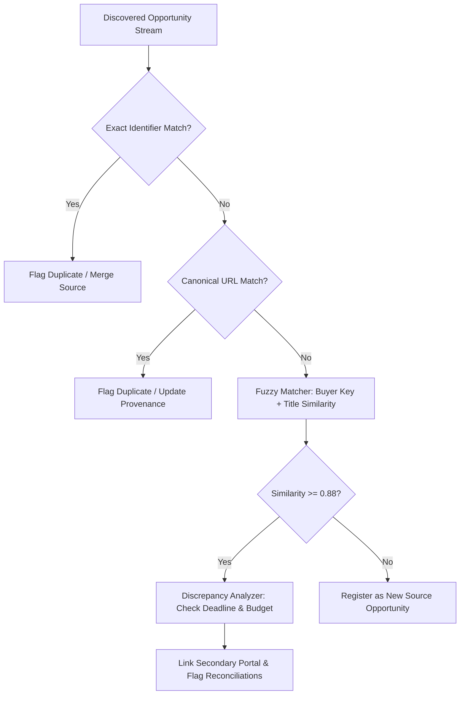

# Phase 5: Multi-Feature Opportunity Deduplication & Reconciliation

## 1. Problem Statement

Public procurement tenders are frequently syndicated, cross-posted, and duplicated across municipal portals, national procurement boards, commercial aggregator feeds, and international gazettes. 

Ingesting duplicate notices wastes proposal evaluation capacity, skews pipeline forecasts, and risks disjoint bid submissions. Furthermore, secondary portals frequently display conflicting metadata—such as altered deadlines or partial budget estimates.

TenderForge employs a **multi-feature deterministic and fuzzy deduplication engine** with discrepancy reconciliation.

---

## 2. Deduplication Strategy & Architecture

---

## 3. Matching Mechanisms

### 3.1 Tier 1: Exact Reference Number Matching
- **Source**: `SourceOpportunity.external_id` and normalized reference numbers (removing hyphens, spaces, and forward slashes).
- **Behavior**: If an opportunity with identical sanitized reference number exists within the organization's scope, it is treated as a duplicate.

### 3.2 Tier 2: Canonical Opportunity URL
- **Source**: Direct portal URL (`opportunity_url`).
- **Sanitization**: Strips query tracking parameters (`utm_*`, `session_id`, `ref`) and trailing slashes.
- **Behavior**: Exact string match identifies direct cross-posts from the same origin URL.

### 3.3 Tier 3: Normalized Buyer + Fuzzy Title Similarity
- **Buyer Key**: Strips common entity suffixes (`Department of`, `Ministry of`, `Govt of`, `Authority`, `Inc`, `LLC`) to create a standardized buyer token.
- **Title Similarity Metric**: `difflib.SequenceMatcher` similarity ratio over lowercased, alphanumeric-normalized titles:
$$\text{Similarity}(T_1, T_2) = \frac{2 \cdot M}{|T_1| + |T_2|}$$
- **Threshold**: Similarity $\ge 0.88$ triggers deduplication linkage.

---

## 4. Discrepancy Reconciliation

When two notices are identified as referencing the same tender opportunity but originate from different procurement sources, TenderForge executes field reconciliation:

| Attribute | Primary Source | Secondary Source | Reconciliation Rule |
| :--- | :--- | :--- | :--- |
| **Title** | Standard Title | Abbreviated Title | Preserves the longest, most descriptive canonical title. |
| **Submission Deadline** | `2026-11-20 17:00` | `2026-11-28 17:00` | Flags a deadline discrepancy. Sets status to latest deadline if secondary is an official corrigendum portal, or creates an alert for human review. |
| **Estimated Budget** | `$4,850,000` | `NULL` | Populates missing valuation from whichever feed provides verified financial data. |
| **Raw Payloads** | Payload 1 | Payload 2 | Aggregates secondary portal metadata into `raw_payload["syndicated_sources"]`. |

---

## 5. Verification & Telemetry

During ingestion, the deduplication engine returns granular counts:
- `fetched_count`: Total items received from remote connector.
- `new_count`: Novel, distinct opportunities committed to the repository.
- `duplicate_count`: Duplicates identified and bypassed.
- `updated_count`: Existing opportunities updated with richer secondary metadata or amendments.
