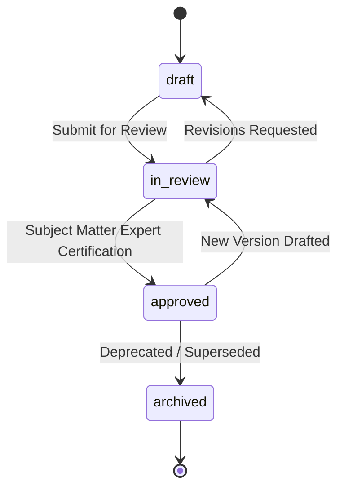

# Phase 5: Proposal Knowledge Library & Asset Reuse

## 1. Overview

Writing proposal sections from scratch for every tender is inefficient and increases the risk of inconsistent messaging, unverified claims, or compliance errors.

The TenderForge **Proposal Knowledge Library** manages high-quality, reusable narrative components—such as corporate security frameworks, methodology descriptions, disaster recovery plans, and executive bios—with strict versioning and lifecycle governance.

---

## 2. Knowledge Asset Data Models

### 2.1 `KnowledgeAsset`
Represents the top-level reusable asset:
- `organization_id`: Tenant boundary.
- `title`: Narrative title (e.g., *"Enterprise Zero Trust Architecture"*).
- `category`: Classification (`technical_approach`, `security_compliance`, `methodology`, `executive_profile`, `corporate_sustainability`).
- `tags`: Indexed keyword tokens for contextual retrieval.
- `current_version`: Integer ($1, 2, 3, \dots$).
- `times_reused`: Automatic counter tracking utilization across proposals.
- `lifecycle_status`: Status lifecycle (`draft`, `in_review`, `approved`, `archived`).

### 2.2 `KnowledgeAssetVersion`
Represents an immutable version snapshot:
- `asset_id`: Foreign key to `KnowledgeAsset`.
- `version_number`: Version sequence.
- `content`: Full textual markdown/plain narrative.
- `approved_by_user_id`: Human editor who certified this narrative.
- `approved_at`: Verification timestamp.

---

## 3. Governance & Lifecycle Flow

Only narratives in the `approved` state are eligible for one-click injection into live proposal drafts.

---

## 4. Proposal Injection Workflow

When a bid author or `ProposalArchitect` agent integrates a knowledge asset into an active proposal:

1. **Section Selection**: Target proposal section is selected (e.g., `Section 3.2 - Information Security`).
2. **Narrative Injection**: Content from the latest approved version of the asset is written into `ProposalSection.content`.
3. **Citation & Lineage**: The section records the asset ID and version in its metadata, enabling audit traceability.
4. **Utilization Telemetry**: Increments `asset.times_reused` by 1 and records the usage event in the organization audit trail.
