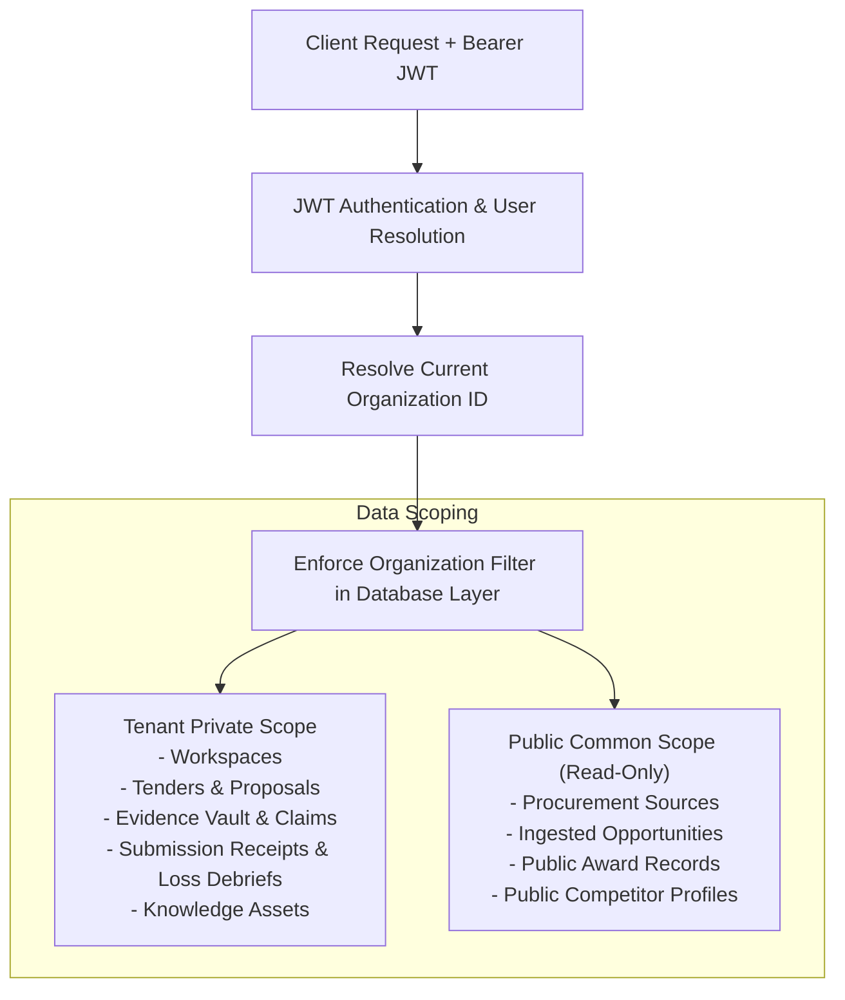

# Phase 5: Security, Privacy & Tenant Isolation

## 1. Overview

Tender bids contain highly confidential intellectual property, commercial margins, executive compensation figures, proprietary past project specifications, and statutory legal credentials. Any leakage across organizations would represent an existential corporate risk.

Phase 5 reinforces **multi-tenant isolation, cryptographically verified role-based access control (RBAC), and network egress defenses**.

---

## 2. Hardened RBAC & Elimination of Client Header Trust

In accordance with Phase 5 pre-upgrade security hardening:
- **Zero Client Header Trust**: The legacy fallback that trusted `X-User-Role` headers was completely eradicated in `backend/app/core/rbac.py`.
- **JWT Cryptographic Enforcement**: Roles (`Admin`, `BidManager`, `Author`, `Reviewer`, `Approver`, `Auditor`) are strictly resolved from authenticated JSON Web Tokens signed with high-entropy cryptographic secrets (`HS256`).
- **Production Secret Validation**: The system blocks execution if default insecure development secrets (e.g. `change-me-in-production`) are detected in production configurations.

---

## 3. Multi-Tenant Isolation Architecture

### 3.1 Tenant Private Scope
Every query accessing `Workspace`, `Tender`, `CompanyEvidence`, `BidSubmissionRecord`, `BidOutcomeRecord`, and `KnowledgeAsset` enforces an immutable `WHERE organization_id = :org_id` filter. Cross-tenant access attempts immediately trigger HTTP 403 Forbidden.

### 3.2 Public Data Boundary
`SourceOpportunity`, `AwardRecord`, and `CompetitorRecord` represent public procurement common data. However:
- Organizations can create private procurement connector sources scoped to their subscription.
- Organizations cannot inspect other tenants' `OpportunityMatch` scores, bidding intent, or workspace promotions.

---

## 4. SSRF & Ingestion Defenses

To defend against Server-Side Request Forgery (SSRF) when communicating with external procurement feeds:
- Non-HTTP/HTTPS protocols (such as `file://`, `gopher://`, `ftp://`) are rejected.
- Private IPv4 address spaces (`10.0.0.0/8`, `172.16.0.0/12`, `192.168.0.0/16`), link-local metadata addresses (`169.254.169.254`), and loopback addresses (`127.0.0.1`, `localhost`, `::1`) are strictly blocked by the connector validation layer.
