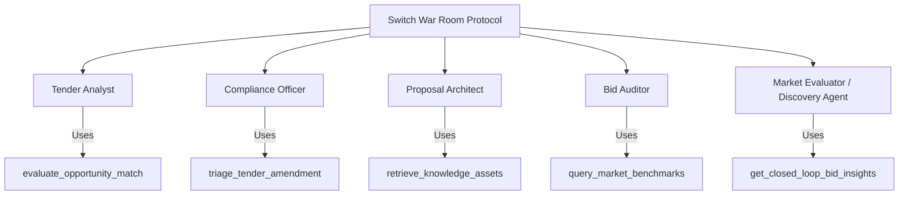

# Phase 5: Switch War Room Coordination & Multi-Agent Collaboration

## 1. Overview

TenderForge coordinates five specialized AI agents within the **Switch War Room** environment. In Phase 5, agent tool access and coordination patterns are extended to encompass proactive opportunity discovery, corrigendum triage, market benchmarks, and knowledge narrative reuse.

---

## 2. Agent Roles & Phase 5 Tool Permitting

### 2.1 Tool Permitting Configuration

Defined in `config/agents/*.yaml` and registered in `backend/app/integrations/switch/tools/definitions.py`:

| Tool Name | Handler | Permitted Agents | Purpose |
| :--- | :--- | :--- | :--- |
| `evaluate_opportunity_match` | `handle_evaluate_opportunity_match` | `TenderAnalyst`, `ComplianceOfficer` | Runs 9-dimension scoring and checks hard gates for an opportunity. |
| `triage_tender_amendment` | `handle_triage_tender_amendment` | `ComplianceOfficer`, `BidAuditor` | Evaluates corrigendum diff, classifies materiality, and outlines downstream action items. |
| `retrieve_knowledge_assets` | `handle_retrieve_knowledge_assets` | `ProposalArchitect`, `TenderAnalyst` | Queries vetted, approved reusable proposal narratives by keyword and category. |
| `query_market_benchmarks` | `handle_query_market_benchmarks` | `TenderAnalyst`, `BidAuditor` | Retrieves historical award pricing, buyer trends, and discount patterns. |
| `get_closed_loop_bid_insights` | `handle_get_closed_loop_bid_insights` | `BidAuditor`, `ProposalArchitect` | Analyzes historical win/loss factors and debrief learnings. |

---

## 3. Human-Agent Co-Pilot Protocol

To maintain complete accountability in public procurement:
1. **Agent Autonomy Limits**: Agents propose, summarize, benchmark, draft, and audit. Agents can never submit a bid, sign a tender certification, or unilaterally decline an opportunity without human confirmation.
2. **Deterministic Tool Execution**: All Switch tool handlers execute verified backend services (`OpportunityMatchingService`, `AmendmentService`, etc.) ensuring identical outcomes whether invoked via REST API or Switch agent chat.
3. **Structured Tool Context**: Switch room messages preserve full tool execution telemetry, parameters, and structured JSON results for auditability.
